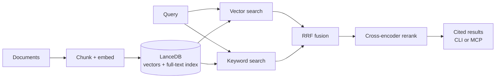

# AI Knowledge Base

Production-grade local hybrid RAG that keeps coding agents current: cited passages from your own documents, served through a read-only MCP (Model Context Protocol) server. LanceDB stores the index and Ollama makes the embeddings, so no documents or queries leave your machine. The first reranker load downloads its model weights from Hugging Face.

The public repo runs on committed synthetic documents.

[](https://github.com/Alpha-W0lf/ai-knowledge-base-public/actions/workflows/ci.yml)
[](https://github.com/Alpha-W0lf/ai-knowledge-base-public/actions/workflows/eval.yml)

## Proof

A pre-registered evaluation: 48 synthetic, AI-written documents in 12 look-alike clusters, 96 graded queries, and a held-out set written blind by a separate agent that saw only the documents. The pre-registration fixes the data by hash, and the results file records the same hashes ([pre-registration](evals/PREREGISTRATION_v2.md), [results](evals/results/2026-10-18_b8ea769.json)).

| Held-out, 48 queries | MRR@10 | nDCG@10 | hit@1 |
|---|---|---|---|
| **Hybrid search + cross-encoder (default)** | **0.948** | **0.962** | **0.896** |
| Hybrid search (RRF fusion, no reranker) | 0.925 | 0.952 | 0.875 |
| Keyword search alone | 0.922 | 0.939 | 0.896 |
| Vector search alone | 0.893 | 0.922 | 0.812 |
| Random order | 0.061 | 0.096 | 0.021 |

The right document comes back first on 90% of held-out queries, against 2% by chance, and the full pipeline scores higher than either search leg alone on MRR@10 and nDCG@10 (against keyword-only, the margin is within the 95% confidence interval). Measured 2026-10-18 with `nomic-embed-text` and `ms-marco-MiniLM-L-6-v2`; the results file records the model revisions and dataset hashes. This repo started as a single-commit snapshot of the development history, so the commit named in the results file is from that pre-release history. On every ranking change, CI reruns the eval on its offline embedder and fails the build if a hybrid-search metric drops more than 0.02 below the committed baseline.

## The problem

AI techniques move weekly, and coding agents that only know their training data fall behind. Teams need a local, citable knowledge path: retrieve what matters, cite the source, and give agents tools they can call safely, without sending private documents to a third party.

## How it works



Meaning-based (vector) search and keyword (full-text) search run side by side. Reciprocal Rank Fusion (RRF) merges the two lists, and a cross-encoder reranker re-scores the top results. CLI, MCP and the eval all call the same `retrieve()` function, and every result carries its citation (`source_id`, `source_url`), its rank in each leg and the stage that produced the final order.

## Key engineering decisions

1. **Hybrid fusion before the cross-encoder.** Search stays fast and useful when the reranker is slow, missing or broken: a failed reranker falls back to the fused ranking and says so (`ranking_stage: fusion_degraded`). Hybrid search stops with a clear error if the keyword index is missing, and an index built with a different embedding model is refused until you rebuild it.
2. **Public fixtures, private corpus.** The repo ships synthetic documents with a license manifest. Your own channels and transcripts stay in git-ignored files, and every citation uses a stable `source_id`, never a local file path.
3. **MCP read-only by default.** The public profile exposes 4 tools, each advertising `readOnlyHint`. Search never writes: ingest builds the index, and a test proves that searching leaves the database files untouched. Tools that change data exist only when `AI_KB_MCP_PRIVATE=1` is set.

## Try it

You need Python 3.11+, [uv](https://docs.astral.sh/uv/) and [Ollama](https://ollama.com).

```bash
uv sync --extra ce                       # dependencies + cross-encoder
ollama pull nomic-embed-text             # local embedding model
uv run python -m src.ingest --fixtures   # index the smoke documents
uv run python -m src.search "reciprocal rank fusion RRF" --hybrid --ce
uv run python -m src.eval                # the 48-document evaluation
```

Set `AI_KB_EMBEDDINGS=stub` to run every command offline on the CI embedder (add `--no-ce` to search and eval or set `AI_KB_CE=0`, or download the reranker once first). To connect an agent, copy [`mcp-config.example.json`](mcp-config.example.json) into your MCP client and set `cwd` to your clone. Audit the server with [mcp-audit](https://github.com/Alpha-W0lf/mcp-audit): `mcp-audit run --server "uv run python -m src.mcp_server"`.

## Stack

Python 3.11+ · LanceDB 0.27 · Ollama `nomic-embed-text` (768-dim) · sentence-transformers cross-encoder `ms-marco-MiniLM-L-6-v2` · MCP Python SDK 2.3 · uv

## Deeper docs

- [`GETTING_STARTED.md`](GETTING_STARTED.md): full setup, MCP wiring and your own YouTube sync
- [`FAQ.md`](FAQ.md): technical FAQ
- [`docs/ARCHITECTURE.md`](docs/ARCHITECTURE.md): retrieval, identity and MCP contracts
- [`evals/PREREGISTRATION_v2.md`](evals/PREREGISTRATION_v2.md): eval data, metrics and criteria
- [`AGENTS.md`](AGENTS.md): how coding agents build and verify this repo
- [`SECURITY.md`](SECURITY.md): security policy
- [`LICENSE`](LICENSE): PolyForm Noncommercial 1.0.0 (source-available, non-commercial)

Built by Thomas (Tom) Chacko, Senior AI Engineer (Ex-Meta). Building agent knowledge systems? Reach me on [LinkedIn](https://www.linkedin.com/in/tchacko1/).
